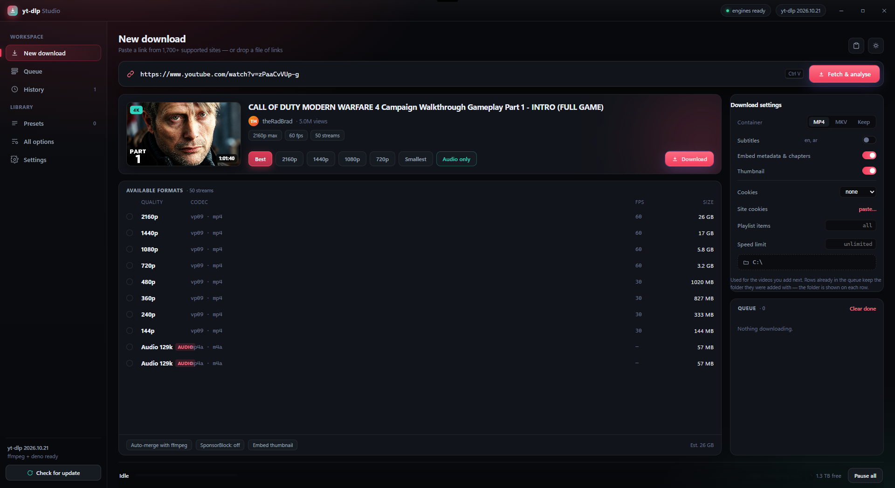
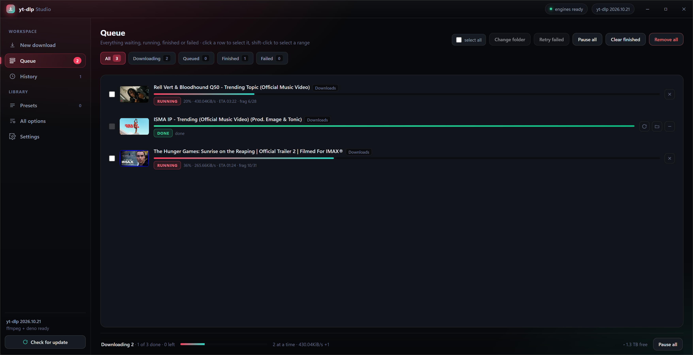

# yt-dlp-GUI Studio App

A desktop app for Windows that puts a real interface on **yt-dlp**: paste a link,
pick a quality, press download. Everything the command line can do — formats,
playlists, subtitles, metadata, cookies — without typing flags.

> **Unofficial.** This is a GUI built by a user of yt-dlp. It is not affiliated
> with, endorsed by, or supported by the yt-dlp project or by any site it can
> download from. Please do not report bugs in this app to them.

---

## Screenshots

Paste a link and the app reads it with yt-dlp: title, channel, duration,
thumbnail and every available format with its codec and size.



Downloads run in a queue — several at once, each row showing progress, speed,
remaining time and the folder it is being saved to.



---

## What it does

- **Paste and go** — one link, a playlist, or a `.txt` file of links; drag and drop works too.
- **Every quality yt-dlp offers**, with codec and file size shown, plus audio-only presets.
- **Queue with parallel downloads** (1–8 at once), pause/resume for the selection, retries, per-batch folders.
- **History** with cached thumbnails and "show in folder".
- **Settings that matter**: download folder, output template, subtitles, metadata/chapter/thumbnail embedding, speed limit, retries, proxy, cookie jars per site.
- **Cookies**: paste an export from Cookie-Editor, or point it at a `cookies.txt`.
- **All 250+ yt-dlp options** generated from the binary's own `--help`, grouped and searchable.
- **Engines are managed for you** — yt-dlp, FFmpeg, ffprobe and Deno ship inside the
  installer, and yt-dlp can be updated from Settings without touching the app.

## Install

**Windows 10 or 11, 64-bit.** Nothing else — no Python, no FFmpeg, no separate
downloads.

Two ways, same app:

**Installer** — `yt-dlp-GUI-Studio-Setup-<version>.exe` from the
[Releases](https://github.com/Jakandev/yt-dlp-gui-studio/releases) page. Installs
for your user only (no admin prompt), adds a Start-menu entry and a desktop
shortcut.

**Portable** — `yt-dlp-GUI-Studio-Portable-<version>.exe`. One file, run it from
anywhere, including a USB stick. Its settings and queue live in a
`yt-dlp-studio-data` folder next to the exe.

Both include yt-dlp, FFmpeg, ffprobe and Deno. The builds are unsigned, so
Windows SmartScreen shows "unknown publisher" on first run — **More info → Run
anyway**.

First launch asks one question: where should downloads go? It suggests your
Downloads folder; pick anything else with **Choose folder**. Nothing is written
until you press Start using it.

## Build from source

Requirements: **Windows**, **Node.js 20+**, and a git checkout.

```bash
git clone https://github.com/Jakandev/yt-dlp-gui-studio.git
cd yt-dlp-gui-studio
npm install
npm run fetch-engines     # downloads yt-dlp, ffmpeg, ffprobe, deno into bin/
npm start                 # run from source
```

Build the two distributables (output in `dist/`):

```bash
npm run build:installer   # NSIS installer
npm run build:portable    # single-file portable exe
```

`bin/` is not in the repository — `npm run fetch-engines` fills it from the
official release pages. See [`THIRD-PARTY-NOTICES.md`](THIRD-PARTY-NOTICES.md)
for the sources and licences of those binaries.

## Where your data lives

| | Installed | Portable |
|---|---|---|
| Settings, queue, history, cookies, thumbnails | `%APPDATA%\yt-dlp Studio\` | `yt-dlp-studio-data\` next to the exe |
| Engines | `%APPDATA%\yt-dlp-studio\bin\` | same |

Uninstalling keeps the data folder on purpose — reinstall and everything is
still there. Settings → **Your data** can import a portable setup into an
installed copy, and the same screen has a settings backup/restore pair.

## Supported sites

Anything **yt-dlp** supports — YouTube, Vimeo, TikTok, Twitch, SoundCloud,
Bandcamp, Reddit, X, Facebook, Instagram, archive.org, direct `.mp4`/`.m3u8`
links and many more. The list is the engine's, not ours; run
`bin\yt-dlp.exe --list-extractors` to see all 1,700+.

On top of that the app adds one thing of its own:

- **A fallback resolver** — when yt-dlp cannot read a page, the app looks for a
  direct media URL in the HTML and hands that URL to yt-dlp instead.

There is no in-app login and no API
keys: if a site needs an account, feed the app a cookie export (Settings →
**Paste site cookies…**) and yt-dlp does the rest.

## How it is put together

```
app/            Electron main process, preload bridge, engine wrapper, UI
  main.js       window, IPC, settings/queue/history storage, cookies, thumbnails
  engine.js     spawns yt-dlp, parses progress, queue, option schema, error mapping
  resolvers.js  the two site helpers described above
  sniffer.js    hidden browser used to render pages that only exist after JS runs
  renderer/     index.html, styles.css, app.js — the interface
bin/            yt-dlp.exe, ffmpeg.exe, ffprobe.exe, deno.exe (fetched, not committed)
build/          icon.ico
scripts/        fetch-engines.js
```

The UI is plain HTML/CSS/JS — no framework, no build step for the renderer.

## Responsible use

This app only drives yt-dlp; it gives you no rights you did not already have.
Download only what you are allowed to download — your own uploads, content
published under a permissive licence, or material you have permission to copy.
Respect each site's terms of service and the law where you live. The authors take
no responsibility for how this tool is used.

## Licence

MIT — see [`LICENSE`](LICENSE). Bundled third-party programs keep their own
licences: [`THIRD-PARTY-NOTICES.md`](THIRD-PARTY-NOTICES.md).
